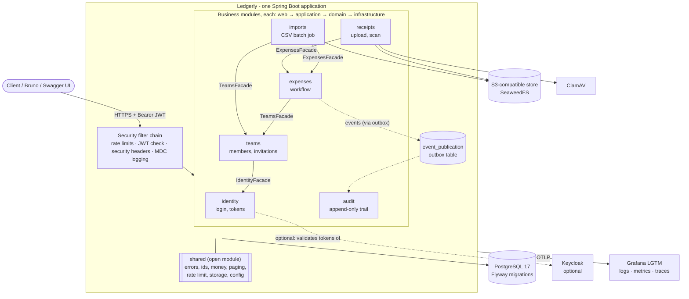
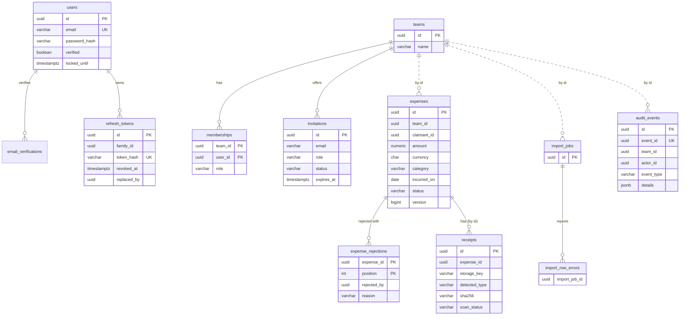

# Ledgerly: a Java & Spring Boot learning project

A REST backend where small teams record expenses, attach receipts and move each expense through an approval workflow.
The product is a pretext: the real goal is to **learn how Java and Spring Boot work** by building one realistic
application with **security by design**, and to refresh that knowledge with working code you can read, break and fix.

> This is a learning project, not a product. Read the code, run the tests, change things. Most decisions are written
> down so you can see _why_, not only _what_ (see [Helpful hints](#helpful-hints)).

## Contents

1. [How to start](#how-to-start)
2. [Commands](#commands)
3. [Architecture and technology](#architecture-and-technology)
4. [Security by design](#security-by-design)
5. [Features and data schema](#features-and-data-schema)
6. [Helpful hints](#helpful-hints)
7. [License](#license)

## How to start

### Requirements

| Tool                         | Why                                                              | Notes                                                 |
| ---------------------------- | ---------------------------------------------------------------- | ----------------------------------------------------- |
| [mise](https://mise.jdx.dev) | Installs the exact JDK and Maven (see `mise.toml`)               | Java 25 (Temurin), Maven 3.9; the repo ships `./mvnw` |
| Docker with Compose          | Postgres, object store, ClamAV, Grafana; Testcontainers in tests | Must be running before you start or test              |
| Node.js (optional)           | Only for `make lint`, `make format`, `make api-test`             | Tools are fetched on demand through `npx`             |

Install the tools (macOS with [Homebrew](https://brew.sh); on Linux or Windows use the installers linked above):

```sh
brew install mise                       # JDK and Maven manager
brew install --cask docker              # Docker Desktop; start it once afterwards
brew install node                       # optional: lint, format and the Bruno API tests
```

### Get the code and install

```sh
git clone https://github.com/AlexisRoe/Ledgerly-Java.git
cd Ledgerly-Java

mise trust                              # allow mise to read mise.toml in this folder
mise install                            # JDK 25 (Temurin) and Maven 3.9
eval "$(mise activate zsh)"             # once per shell (use bash instead of zsh if needed), or add it to ~/.zshrc

java -version                           # should print 25
./mvnw -B -DskipTests package           # downloads dependencies and checks that the build works
```

Prefer SSH? `git clone git@github.com:AlexisRoe/Ledgerly-Java.git`.

### Option A: everything in Docker (quickest)

```sh
make up                 # builds the image, starts the app and all dependencies
```

- API: http://localhost:8080
- Swagger UI: http://localhost:8080/docs (local profile only)
- Grafana (logs, metrics, traces): http://localhost:3000 (`admin` / `admin`)

The first start is slow: ClamAV downloads its virus signatures (a few minutes), and the image has to be built.
The database is filled with demo data (below). Stop with `make down`, or `make reset` to also delete the data.

### Option B: develop on the host

```sh
make run                # app from Maven (profile "local"); the dependencies start from compose.yaml
make debug              # same, but waits for a debugger on port 5005
```

Spring Boot's Docker Compose support starts Postgres, the object store, ClamAV and Grafana for you. Use
`make deps` if you want them running without the app.

### Try it

With the `local` profile an empty database is seeded with a demo team ("Acme Travel"). All passwords are
`correct-horse-battery`.

| User                | Role                                                     |
| ------------------- | -------------------------------------------------------- |
| `alice@example.com` | OWNER                                                    |
| `bob@example.com`   | APPROVER                                                 |
| `carol@example.com` | MEMBER, with expenses in every status (one rejected)     |
| `dave@example.com`  | not a member, email unverified, has a pending invitation |

```sh
curl -s localhost:8080/api/v1/auth/login -H 'Content-Type: application/json' \
  -d '{"email":"alice@example.com","password":"correct-horse-battery"}'
```

Use the returned access token as `Authorization: Bearer <token>`. Ready-made requests live in `bruno/` (a
[Bruno](https://www.usebruno.com) collection with assertions) and `http/` (`.http` files for IntelliJ and VS Code).

### Configuration

Copy `.env.example` to `.env` (git-ignored) only if you need to override something. Local development needs no
secrets: the `local` profile generates a throwaway JWT key at start-up. Outside `local`/`test` you must provide keys,
storage credentials and allowed origins, and the application refuses to start without them.
See [`docs/deployment.md`](docs/deployment.md).

### Run the tests

```sh
make test               # all tests; needs Docker (Testcontainers starts real Postgres, S3 and so on)
make test-one T=ExpensesApiTest
make verify             # what CI runs: tests + formatting + NullAway null-safety checks
```

Tests use real infrastructure instead of mocks wherever the behaviour depends on it (SQL, transactions, object
storage), plus architecture tests that fail when a module reaches into another module's internals.

## Commands

`make` lists every target. The ones you will use most:

| Command                   | What it does                                                          |
| ------------------------- | --------------------------------------------------------------------- |
| `make run` / `make debug` | Run on the host (debug waits for a debugger on :5005)                 |
| `make up` / `make down`   | Build the image and run everything in Docker / stop it, keep the data |
| `make reset`              | Stop and **delete** the data                                          |
| `make deps`               | Start only Postgres, object store, ClamAV and Grafana                 |
| `make logs` / `make ps`   | Follow the app's container logs / list containers                     |
| `make test`               | All tests                                                             |
| `make test-one T=<Class>` | One test class                                                        |
| `make verify`             | Tests plus all build checks (what CI runs)                            |
| `make lint`               | Spotless (Java), Prettier (YAML/JSON), Redocly (OpenAPI)              |
| `make format`             | Fix formatting                                                        |
| `make api-test`           | Run the Bruno collection against the running app (`make up` first)    |
| `make image`              | Build the container image only                                        |
| `make clean`              | Delete build output                                                   |

## Architecture and technology

### A modular monolith

One deployable Spring Boot application split into six business modules plus a `shared` kit. Modules talk to each
other only through a public **facade** (reads and commands) or through **events** (reactions). Everything under
`internal` is private, and [Spring Modulith](https://spring.io/projects/spring-modulith) plus an ArchUnit test fail the
build if a module breaks that rule. The result has microservice-style boundaries without network calls, and each module
could be extracted later.



Solid arrows are calls through a public facade, dotted arrows are events. Inside each module the layers point inward:
`web` → `application` → `domain`, with `infrastructure` implementing the interfaces the inner layers define. Module
documentation and PlantUML diagrams are generated into [`docs/modules/`](docs/modules/) by a test, so they cannot drift.

### Technology

| Concern                  | Choice                                                                                    |
| ------------------------ | ----------------------------------------------------------------------------------------- |
| Language                 | Java 25 (LTS): records, sealed types, pattern matching, virtual threads                   |
| Framework                | Spring Boot 4.2 (Spring Framework 7, Jakarta EE 11), Spring MVC                           |
| Build                    | Maven with the wrapper, JDK and Maven versions managed by mise                            |
| Database                 | PostgreSQL 17, Spring Data JPA (Hibernate), Flyway migrations                             |
| Modularity               | Spring Modulith (boundary verification, event outbox, generated docs)                     |
| Security                 | Spring Security 7, OAuth2 resource server (JWT, ES256), Argon2id password hashing         |
| Files                    | S3 API (SeaweedFS locally), Apache Tika type sniffing, ClamAV malware scan                |
| Batch                    | Spring Batch 6 for CSV import                                                             |
| Rate limiting            | Bucket4j + Caffeine                                                                       |
| API contract             | Contract-first OpenAPI 3.1 in `api/openapi.yaml`, Swagger UI in the local profile         |
| Observability            | Structured JSON logs, Micrometer, OpenTelemetry, Grafana LGTM stack                       |
| Null safety              | JSpecify annotations + NullAway at compile time                                           |
| Testing                  | JUnit 5, AssertJ, Testcontainers, ArchUnit, Spring Modulith tests                         |
| Quality and supply chain | Spotless, Prettier, Redocly, gitleaks, Trivy, Renovate, Maven Enforcer, pinned CI actions |
| Optional identity        | Keycloak instead of the built-in login (profile `keycloak`)                               |

### Profiles

| Profile    | Purpose                                                                                       |
| ---------- | --------------------------------------------------------------------------------------------- |
| `local`    | Development: readable logs, throwaway JWT key, Swagger UI, demo data. Never use in production |
| `test`     | Automated tests (demo data is not loaded)                                                     |
| `prod`     | Strict: refuses to start without keys, storage config and explicit CORS origins               |
| `keycloak` | Validate tokens issued by Keycloak; Ledgerly creates its user on the first valid token        |

## Security by design

Security is built in from the first milestone rather than added at the end. A few examples you can find in the code:

- **Deny by default.** Every path needs a valid token except a short, explicit list (`SecurityConfig`).
- **Short-lived access tokens** (10 minutes), **rotating refresh tokens** (14 days) with token-family revocation, stored
  only as hashes.
- **Argon2id** password hashing, same response for "wrong password" and "unknown email", account lockout.
- **Roles are checked on every call** (Owner ⊃ Approver ⊃ Member). A non-member gets 404, not 403, so team ids cannot be
  probed.
- **Optimistic locking** with `ETag` / `If-Match` and **idempotency keys** against double submits.
- **Upload hygiene:** size limits, content sniffing (not the file name), malware scan, private storage, time-limited
  download links, quarantine for infected files.
- **Rate limits** per user and per client address; **hardening headers** (CSP, HSTS, no-referrer, no framing); strict CORS.
- **Append-only audit trail** enforced in the database with triggers and revoked privileges, not only in code.
- **Errors as RFC 9457 Problem Details** that never leak internals; no secrets or personal data in logs.
- **Supply chain:** dependency checksums, pinned and digest-locked images and CI actions, secret scanning, image scan.
  See [`docs/local-hardening.md`](docs/local-hardening.md).

## Features and data schema

### Features

- **Accounts:** register, verify email, log in, refresh, log out. Email delivery is a logged event, not a real mail.
- **Teams:** create a team, invite by email, accept or decline, change roles, remove members, leave.
- **Expenses:** amount (`BigDecimal`, never `double`), currency, category, date, merchant, note. Filter, sort and page,
  export as CSV, create up to 100 at once with per-item results.
- **Approval workflow:** `DRAFT → SUBMITTED → APPROVED → REIMBURSED`. A submitted expense can be withdrawn to DRAFT by
  the claimant or rejected (with a reason) by an approver, and a rejected one can be reopened. APPROVED cannot be undone;
  REIMBURSED is final.
- **Receipts:** PDF, JPEG or PNG per expense, scanned for malware, duplicate detection by SHA-256.
- **CSV import:** thousands of rows as a background Spring Batch job with a status endpoint and per-row errors.
- **Audit trail:** who did what and when, cursor-paged, readable by owners only.

The complete contract is [`api/openapi.yaml`](api/openapi.yaml); all paths live under `/api/v1`.

### Data schema

Modules never join across each other's tables; they reference other modules' rows by id only
([ADR 0001](docs/adr/0001-users-referenced-by-id-only.md)), which is why most cross-module columns have no foreign
key.



Not drawn: `idempotency_keys`, `event_publication` (the Modulith outbox) and the `BATCH_*` tables of Spring Batch.
Schema changes are Flyway migrations in `src/main/resources/db/migration/` (never edit an applied one; add the next
`V<n>__*.sql`).

## Helpful hints

**Where to read first**

| File                                                         | What you get                                                                             |
| ------------------------------------------------------------ | ---------------------------------------------------------------------------------------- |
| [`CONCEPT.md`](CONCEPT.md)                                   | The idea, the stack and why each piece was chosen                                        |
| [`GLOSSARY.md`](GLOSSARY.md)                                 | The domain language (Team, Membership, Verified, ...); the glossary wins over other text |
| [`docs/adr/`](docs/adr/)                                     | Architecture decisions with reasons                                                      |
| [`docs/learning-log.md`](docs/learning-log.md)               | What each milestone taught                                                               |
| [`docs/implementation-plan.md`](docs/implementation-plan.md) | The milestone-by-milestone build order (M0 to M11)                                       |
| [`docs/deployment.md`](docs/deployment.md)                   | Running outside your laptop, ports, Keycloak, demo data                                  |
| [`docs/local-hardening.md`](docs/local-hardening.md)         | How the dev setup is protected against supply-chain attacks and leaked secrets           |

**A suggested way to learn from the code**

1. Follow one request: `POST /teams/{id}/expenses` from the controller in `expenses/internal/web`, through the
   application service and the domain object, to the repository and the Flyway table.
2. Open `ModularityTest` and try to break a module boundary; read the failure.
3. Read `SecurityConfig`, then the `05-security` Bruno folder, to see each protection and its proof.
4. Change a rule in the expense workflow and let the tests tell you what you broke.

**Good to know**

- Main classes carry Javadoc that explains _why_, not only _what_.
- Money is `BigDecimal` with a currency, never a `double`.
- Ids are UUIDv7 (time-ordered), generated in the application.
- `shared` is an _open_ module on purpose: it holds cross-cutting code, not business rules.
- The `local` profile is intentionally permissive (no auth on Swagger UI, ports published on `127.0.0.1` only). Do not
  deploy it.
- ClamAV needs a few minutes on first start; receipt tests and the lifecycle Bruno folder need it running.
- On Apple Silicon the ClamAV image runs under emulation (`platform: linux/amd64` in `compose.yaml`).
- Actuator (health, metrics) runs on its own port 8081 and must not be published in production.
- Pre-commit hooks are available (`.pre-commit-config.yaml`); CI runs build, OpenAPI lint, Prettier check, gitleaks
  and an image scan on every pull request to `main`.

## License

[MIT](LICENSE) © 2026 Alexis Roehrling
